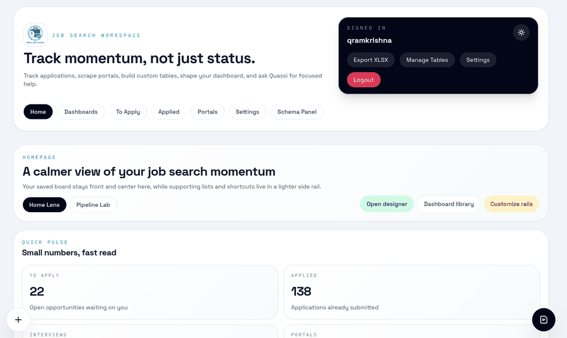
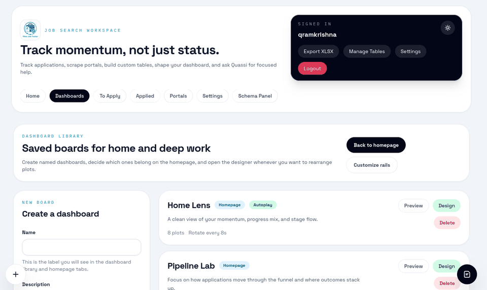
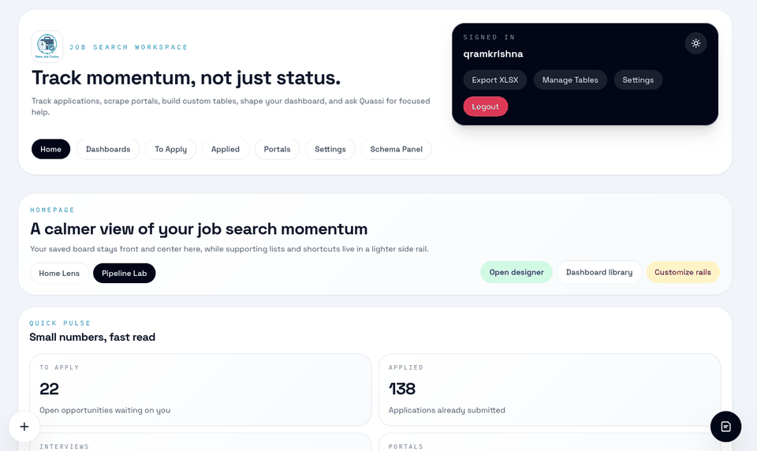
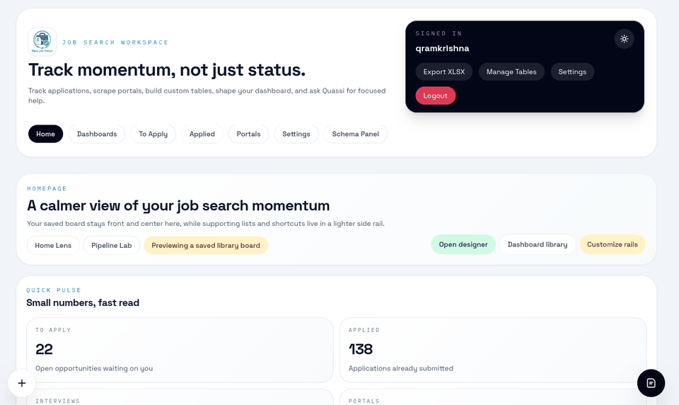
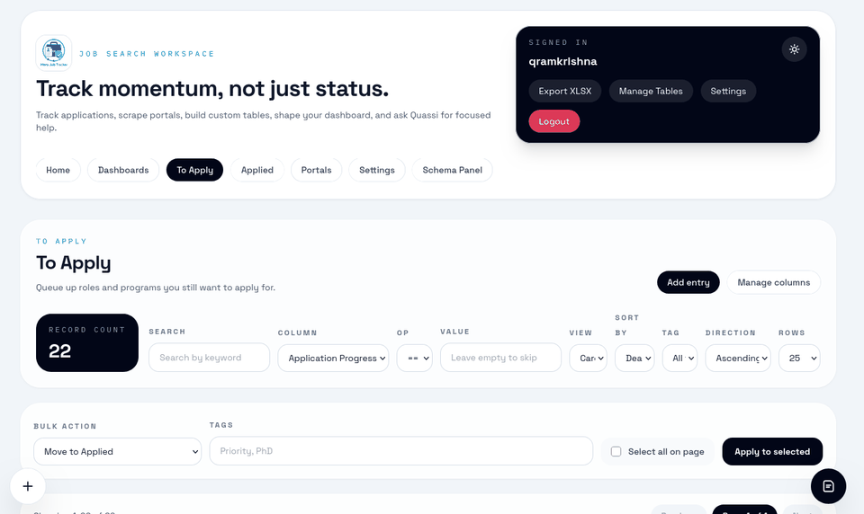
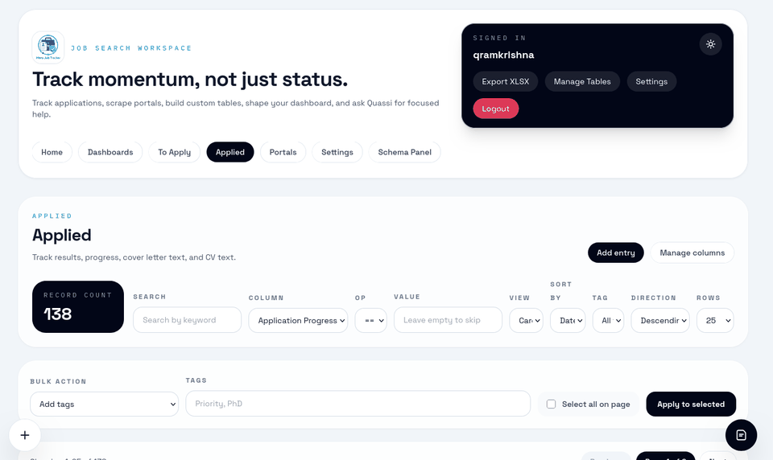
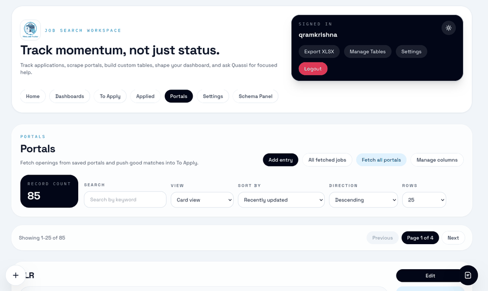
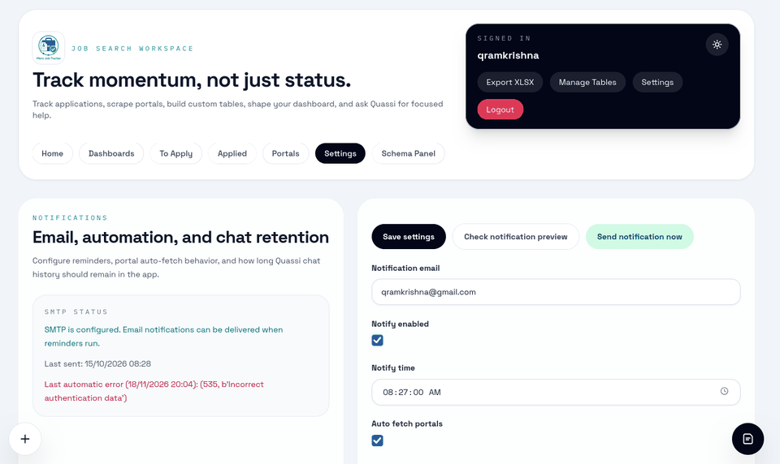
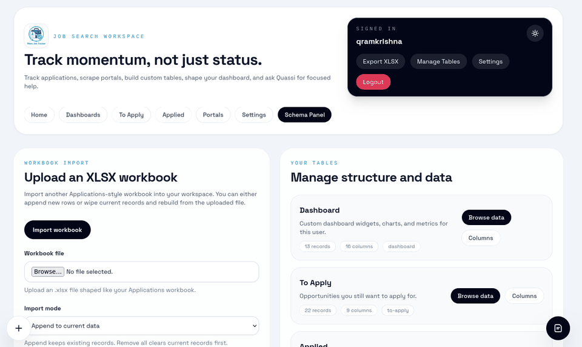

# Job Tracker

Python full-stack job-search tracker built with Django, SQLite, Django REST Framework, Tailwind-styled templates, and a flexible per-user table system.

## What it includes

- User-specific `tables`, `columns`, and `data`
- Excel-driven default workspace seeded from `Applications.xlsx`
- `To Apply`, `Applied`, `Portals`, and `Dashboard` tables
- Cover letter and CV text storage for applied roles
- Applied progress tracking
- In-app schema panel to create tables and columns
- Portal scraping flow that can push discovered jobs into `To Apply`, with a Selenium browser fallback for 403 and JavaScript-heavy portals
- Floating RAG chat assistant with quick prompts and a CPU-friendly local model path
- Standalone SMTP notification script with optional portal auto-fetch
- Local `.env` setup with seeded `admin` and `testuser` accounts

## Demo walkthrough

These scrolling captures show the tracker with real account data.

<details>
<summary>Home — Home Lens</summary>


</details>

<details>
<summary>Dashboard library</summary>


</details>

<details>
<summary>Pipeline Lab</summary>


</details>

<details>
<summary>Deadline Radar</summary>


</details>

<details>
<summary>To Apply</summary>


</details>

<details>
<summary>Applied</summary>


</details>

<details>
<summary>Portals</summary>


</details>

<details>
<summary>Settings</summary>


</details>

<details>
<summary>Schema Panel</summary>


</details>

## Setup

1. Create and activate a virtual environment.
2. Install the project:

```powershell
python -m venv .venv
.\.venv\Scripts\python -m pip install -e .
```

Selenium will use a local Edge or Chrome installation for tougher portal pages. If a portal blocks normal HTTP requests, the app now falls back to a real browser session automatically.

Optional portal scraping env vars:
- `PORTAL_FETCH_MODE=auto|requests|browser`
- `PORTAL_BROWSER=auto|edge|chrome`
- `PORTAL_BROWSER_VERBOSE_LOGS=true` to show raw Selenium/Edge diagnostics again

3. Run migrations:

```powershell
.\.venv\Scripts\python run.py migrate
```

4. Bootstrap the local users and import Excel data for the seeded test user:

```powershell
.\.venv\Scripts\python run.py bootstrap --replace
```

5. Start the dev server:

```powershell
.\.venv\Scripts\python run.py serve
```

6. Optional: send notifications from the standalone SMTP script:

```powershell
.\.venv\Scripts\python scripts\send_notifications.py --dry-run
```

You can also use the Typer CLI after installation:

```powershell
job-tracker --help
job-tracker serve
job-tracker notify --dry-run
```

## Local credentials

Credentials and SMTP settings are stored in `.env`.

- Admin: `ADMIN_USERNAME` / `ADMIN_PASSWORD`
- Test user with imported Excel data: `TEST_USERNAME` / `TEST_PASSWORD`

## Remote database

Update `DATABASE_URL` in `.env` to point to your remote database when you are ready. SQLite remains the default local option.

## Local chat assistant

The chat widget in the bottom-right corner uses retrieval over your own tables and fetched portal jobs. It can also use a light local generation model on CPU.

- Enable or disable the local model with `RAG_ENABLE_LOCAL_MODEL`
- Change the model with `RAG_MODEL_NAME`
- The default model target is `google/flan-t5-small`

If the local model dependencies are not installed yet, the assistant still works in retrieval mode and cites the strongest matching records from your data.

## SMTP handling

The reusable SMTP integration lives in `tracker/smtp_handler.py` as the `SMTPHandler` class. The notification workflow uses it both from `scripts/send_notifications.py` and from the Typer-powered `run.py notify` command.
